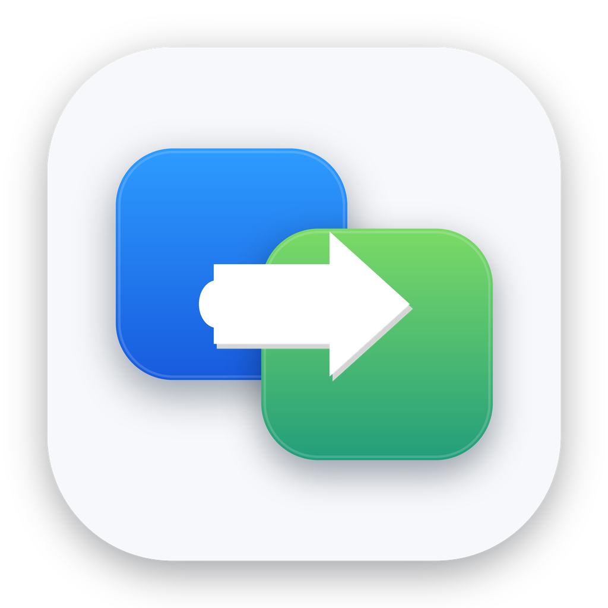

<p align="center">
  
</p>

<h1 align="center">LibreReplace</h1>

<p align="center"><strong>Cut Mac software costs with powerful free and open-source alternatives.</strong></p>

<p align="center">A native macOS app that analyzes paid software feature by feature, builds complete replacement setups from free apps and built-in tools, and helps you switch with confidence.</p>

<p align="center"><strong>45 paid apps · 70 free-alternative comparisons · 100 catalog products · Built-in OCR &amp; PDF tools</strong></p>

---

## Free software, without the compromises of a basic alternatives list

Paying for a subscription makes sense when you need what it offers. But plenty of expensive Mac apps can be replaced—fully or in part—by excellent free software. **The difficult part is finding the right combination without losing the features you depend on.**

LibreReplace tackles that problem with a feature-aware replacement engine. Select an app, mark the capabilities that matter, and get ranked free setups built around your requirements. See how each app contributes, where the gaps are, and whether LibreReplace's built-in tools can fill them.

**One replacement might be enough. When it isn't, LibreReplace can put several free tools together.**

## What makes LibreReplace different

| Capability | What you get |
|---|---|
| **Feature-by-feature comparisons** | Choose your must-haves and see how free alternatives measure up, including partial coverage and missing capabilities. |
| **FreeStack combinations** | Explore setups that combine multiple free apps and LibreReplace tools instead of settling for a single imperfect substitute. |
| **Built-in feature bridges** | Handle OCR, searchable PDFs, PDF combination, supported PDF recovery and image conversion inside LibreReplace. |
| **Saved replacement setups** | Save the exact apps, tools and requirements you selected. Resume or refine your plan later. |
| **Guided switching** | Check what's installed, review optional installation steps, try real tasks and use backup/recovery for supported migrations. |
| **Community recipes** | Import, customize and export portable replacement setups instead of rebuilding them from scratch. |
| **Software-cost overview** | Scan supported installed apps and estimate potential recurring savings from prices you enter. |

### A smarter replacement can be more than one app

**CleanShot X → free screenshot capture + LibreReplace Image OCR.** Choose screenshots and text extraction as essentials, and LibreReplace can suggest a capture app alongside its own on-device OCR. The result is one saved plan with two complementary tools.

**Adobe Acrobat Pro → compare editing and document-processing combinations.** Choose the PDF capabilities you need, review options such as LibreOffice Draw and LibreReplace's document tools, and see which tasks each setup addresses.

**Photoshop, Transmit, TextExpander and more.** Explore free options with requirements that change the recommendation—not a generic ranking that ignores your work.

## Real tools, built into the Mac app

LibreReplace does more than send you to download links. Its on-device toolbox includes:

- **Extract text** from screenshots, images and supported PDFs.
- **Combine PDFs** in a chosen order.
- **Make scanned PDFs searchable** with a text layer.
- **PDF Rescue** for supported document-recovery tasks.
- **Convert images** between supported formats, including batch processing.

When a replacement setup uses an included tool, LibreReplace opens the relevant workflow and lets you return to the same saved setup afterward.

## Five sections. One connected experience.

| Section | Purpose |
|---|---|
| **Discover** | Browse paid apps, set your requirements and compare complete free replacement setups. |
| **My Setups** | Save, reopen and refine plans; access supported migration workflows. |
| **Tools** | Use local document and image utilities immediately. |
| **Community** | Import, export and contribute reusable replacement recipes. |
| **My Mac** | See recognized installed apps, free options and potential software-cost reductions. |

Start with the features you need. Compare the suggested setups. Try what's already available. Save the combination worth keeping. **You can explore all of this without installing another app.**

## Get LibreReplace

### LibreReplace Studio — current source

The new five-section experience is available in the repository. Build it on macOS 14 or later with Xcode, Python 3 and XcodeGen:

```bash
git clone https://github.com/maliroq/librereplace.git
cd librereplace
brew install xcodegen
./Scripts/install_local.sh
```

[Build instructions](Docs/BUILDING.md) · [Studio walkthrough](Docs/STUDIO_GUIDE.md) · [Complete changelog](CHANGELOG.md)

### Downloadable preview

[Download v0.2.0-preview.1](https://github.com/maliroq/librereplace/releases/tag/v0.2.0-preview.1) or install it with `brew install --cask maliroq/tap/librereplace`.

This earlier downloadable edition focuses on comparisons. **The Studio features described above are currently available from source** while the new downloadable version is prepared.

## Built for macOS. Built around your choices.

LibreReplace is a native SwiftUI app with local app detection, on-device file processing and no required account, ads or telemetry. It never removes paid applications or cancels subscriptions on its own. For supported migrations, you can review changes and restore backed-up settings.

**Open source under Apache 2.0.** Help improve the comparisons, add a tested workflow recipe, or make the app even better.

[Contribute](CONTRIBUTING.md) · [Supported apps](Docs/SUPPORT_MATRIX.md) · [Community recipes](Docs/STUDIO_COMMUNITY_BUILD_GUIDE.md) · [Privacy](Docs/PRIVACY.md) · [Issues](https://github.com/maliroq/librereplace/issues)
