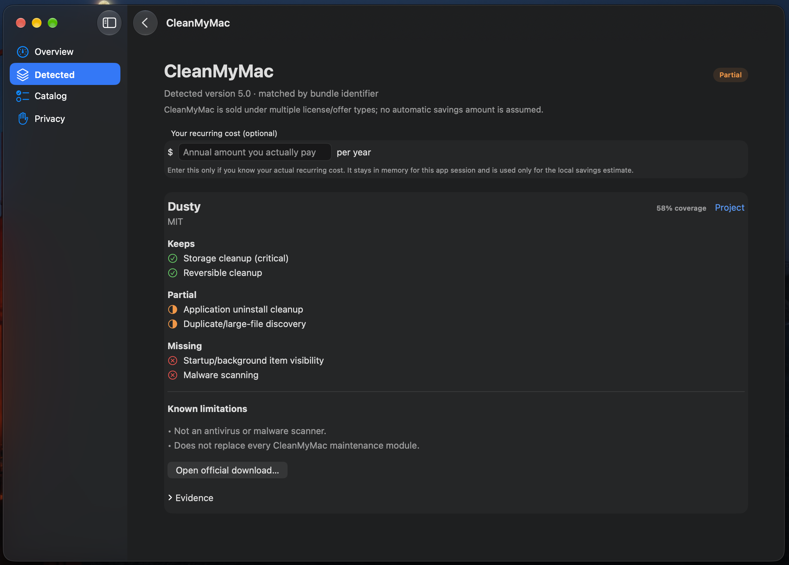
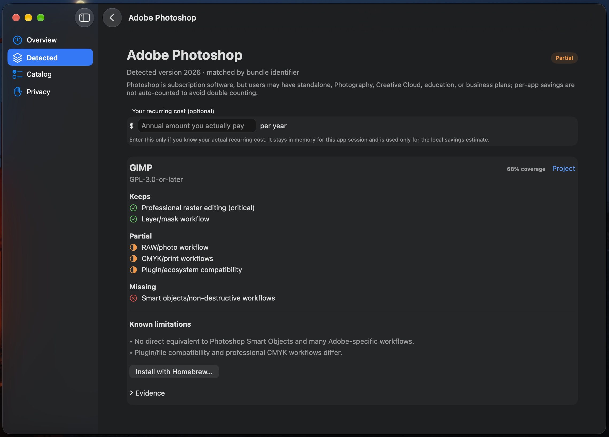
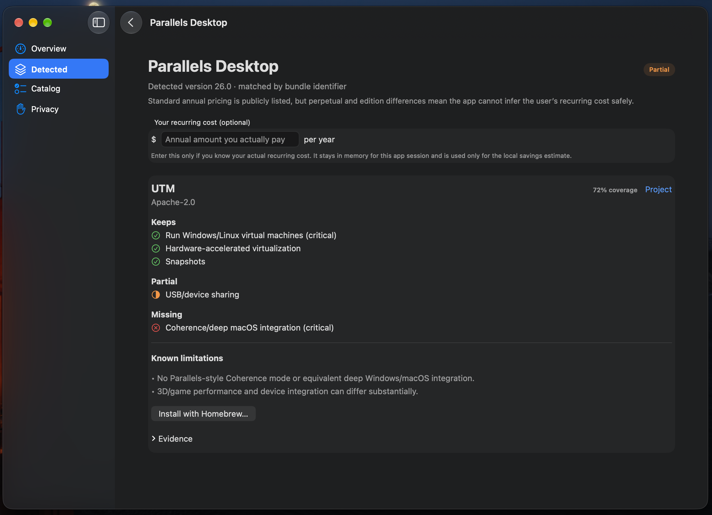
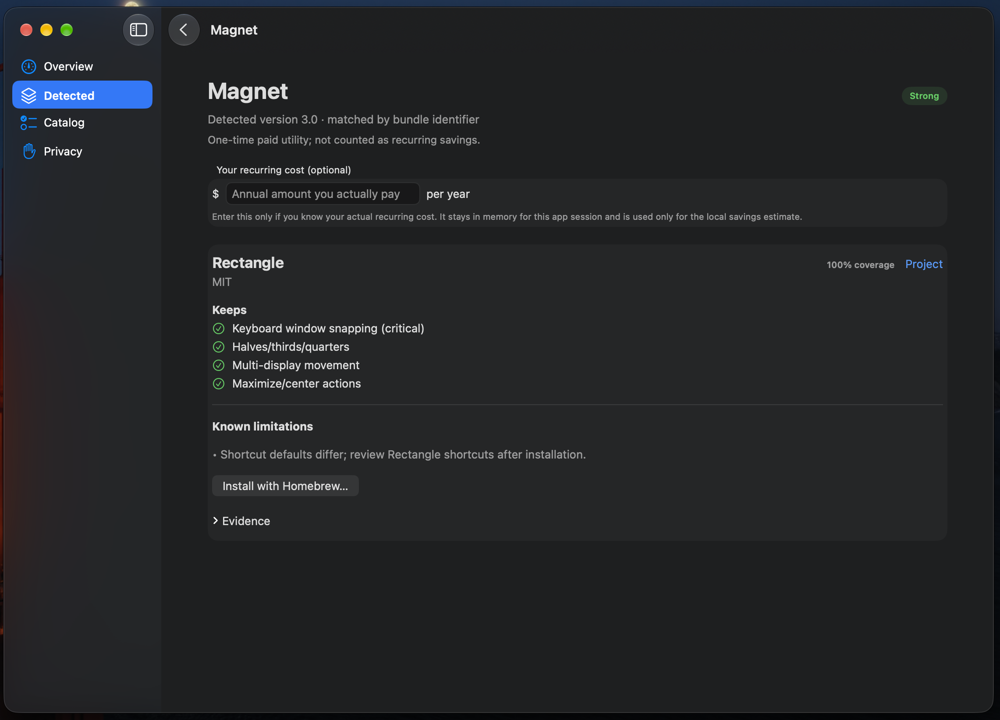

<p align="center">
  
</p>

<h1 align="center">LibreReplace</h1>

<p align="center"><strong>See what you gain — and what you lose — before replacing a paid Mac app.</strong></p>

<p align="center">LibreReplace scans supported apps already installed on your Mac, compares them with curated open-source alternatives, and shows explicit gains, losses, and a Strong / Partial / Keep recommendation before you switch.</p>

<p align="center"><strong>Local-only · No account · No telemetry · Never removes your existing app automatically</strong></p>



### Quick install

[Download v0.2.0-preview.1 for macOS](https://github.com/maliroq/librereplace/releases/tag/v0.2.0-preview.1) or build locally from source. Homebrew: `brew install --cask maliroq/tap/librereplace`.

> **Preview distribution:** the downloadable app is ad-hoc signed and not Apple-notarized. The Homebrew Cask does not remove quarantine or disable Gatekeeper.

LibreReplace is not another alternatives directory. It can start from a supported installed app or from Explore Alternatives, shows exactly where an open-source replacement falls short, and can conclude **KEEP THIS APP** when switching would cost too much of your workflow.

## Example comparisons

LibreReplace is designed to show where a replacement falls short, not just where it looks similar.

<p align="center">
  
  
</p>

<p align="center">
  
</p>

## What it does

- Scans `/Applications`, `/System/Applications`, and `~/Applications` for application bundles.
- Reads only application metadata from `Contents/Info.plist` during the normal scan.
- Recognizes 45 curated commercial targets using 55 researched bundle-ID mappings plus conservative name aliases.
- Compares 70 open-source alternatives and reports **Strong**, **Partial**, or **Keep** depending on what you need.
- Shows weighted capability coverage, critical missing features, known limitations, source/license evidence, and verification dates.
- Opens verified official download pages or, after confirmation, runs a typed Homebrew action without shell interpolation.
- Shows potential annual savings from user-confirmed recurring costs when a selected Strong open-source edition is free and the old subscription can be cancelled. Hosted services with unverified costs are excluded.
- Exports a local Markdown summary that omits application names by default.
- Supports one narrow migration: Sublime Text preferences → Zed settings, with preview, verified backup, verification, and rollback.

## Why it is different

General alternatives directories are useful for discovery. LibreReplace answers a more specific question: **can I replace this app on my Mac without breaking the parts of my workflow I care about?**

For each supported app, the catalog records capabilities, critical requirements, explicit losses, installation provenance, source/license evidence, and verification dates. Unknown support does not count as parity. Stale evidence cannot produce a Strong recommendation.

## Install

### Homebrew Cask

Install the current preview with `brew install --cask maliroq/tap/librereplace`, download the release DMG, or build from source.

LibreReplace v0.2.0-preview.1 is distributed as an ad-hoc-signed, non-notarized Mac app. The Cask does not remove quarantine attributes or disable Gatekeeper. macOS may require you to approve LibreReplace in **System Settings → Privacy & Security → Open Anyway**.

### DMG

Download `LibreReplace-v0.2.0-preview.1.dmg` from the [v0.2.0-preview.1 release](https://github.com/maliroq/LibreReplace/releases/tag/v0.2.0-preview.1).

### Build locally from source

```bash
git clone https://github.com/maliroq/LibreReplace.git
cd LibreReplace
brew install xcodegen
./Scripts/install_local.sh
```

The local installer builds and ad-hoc signs the app without using Apple credentials or weakening Gatekeeper. See [Building from source](Docs/BUILDING.md) and [Local verification](Docs/LOCAL_VERIFICATION.md).

## Supported applications

The preview covers **45 commercial targets and 70 open-source comparisons**. Decisions adapt to your chosen essential features; they are workflow estimates, not guarantees of identical performance, accessibility, security, support or file-format fidelity.

See the [support matrix](Docs/SUPPORT_MATRIX.md) for every source app, alternative, recommendation level, and major limitation.

## Safety and privacy

Scanning and recommendation are local. LibreReplace has no account system, telemetry, analytics, ads, remote inventory service, or background daemon.

The normal scanner does not read Documents, Desktop, Keychain, browser profiles, passwords, project files, or unrelated application data. Installation always requires confirmation. LibreReplace never automatically uninstalls the source app. The migration adapter is preview-first and narrowly constrained to documented non-sensitive editor preferences.

See [Privacy](Docs/PRIVACY.md), [Threat model](Docs/THREAT_MODEL.md), and [Migration safety](Docs/MIGRATIONS.md).

## Known limitations

Catalog coverage is finite, evidence ages, feature coverage is a maintained judgment, and only one migration adapter exists. The preview has not completed Developer ID signing/notarization or a dedicated independent VoiceOver/keyboard-navigation review.

See [Known limitations](Docs/LIMITATIONS.md).

## Building from source

For the full macOS gate:

```bash
python3 dev.py
```

For portable core/catalog development:

```bash
make check
```

The generated Xcode project is disposable; `project.yml` is the source of truth.

## Contributing

### Add or verify an app replacement

Catalog quality matters more than catalog size. Contributions should use primary evidence where practical, record exact workflow losses, preserve critical features, and downgrade uncertain claims rather than guessing parity.

The preview target set is frozen for release; verification and corrections to existing entries are immediately useful. New target proposals should start with an issue until maintainers reopen catalog scope.

See [Contributing](CONTRIBUTING.md) and [Catalog schema](Docs/CATALOG_SCHEMA.md).

## Technical and security documentation

- [Architecture](Docs/ARCHITECTURE.md)
- [Threat model](Docs/THREAT_MODEL.md)
- [Privacy](Docs/PRIVACY.md)
- [Migration safety](Docs/MIGRATIONS.md)
- [Catalog schema](Docs/CATALOG_SCHEMA.md)
- [Validation](Docs/VALIDATION.md)
- [Release process](Docs/RELEASING.md)
- [Security policy](SECURITY.md)

## License

Apache-2.0. See [LICENSE](LICENSE).
