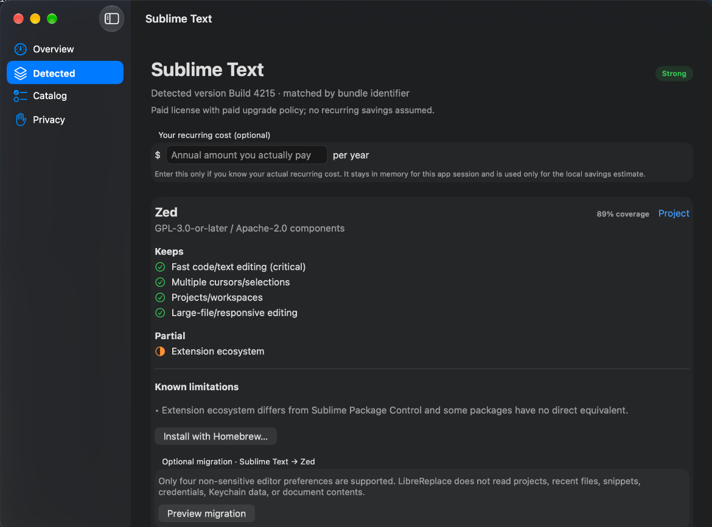

<p align="center">
  
</p>

<h1 align="center">LibreReplace</h1>

<p align="center"><strong>Replace paid Mac apps without losing what matters.</strong></p>

<p align="center">LibreReplace scans applications already installed on your Mac, matches supported commercial software with evidence-backed open-source alternatives, and shows what you gain — and what you would lose — before you switch.</p>

<p align="center"><strong>Local-only · No account · No telemetry · Never removes your existing app automatically</strong></p>



<!-- launch-foundation:source-preview-status -->
> **No-cost preview:** The recommended install is a local source build. A downloadable DMG is also available, but it is ad-hoc signed and not Apple-notarized; see **Install** below for the exact options and first-launch disclosure.

LibreReplace is not another alternatives directory. It starts from a supported app you actually have installed, models the workflow capabilities that matter, shows explicit limitations and dated evidence, and can conclude **KEEP THIS APP** when an open-source replacement is not good enough.

## What it does

- Scans `/Applications`, `/System/Applications`, and `~/Applications` for application bundles.
- Reads only application metadata from `Contents/Info.plist` during the normal scan.
- Recognizes 25 curated commercial Mac applications using 41 known bundle identifiers plus conservative name aliases.
- Ranks one evidence-backed open-source alternative per launch target as **Strong**, **Partial**, or **Keep**.
- Shows weighted capability coverage, critical missing features, known limitations, source/license evidence, and verification dates.
- Opens verified official download pages or, after confirmation, runs a typed Homebrew action without shell interpolation.
- Counts savings only from recurring annual costs the user explicitly enters for the current session.
- Exports a local Markdown summary that omits application names by default.
- Supports one narrow migration: Sublime Text preferences → Zed settings, with preview, verified backup, verification, and rollback.

## Why it is different

General alternatives directories are useful for discovery. LibreReplace answers a more specific question: **can I replace this app on my Mac without breaking the parts of my workflow I care about?**

For each supported app, the catalog records capabilities, critical requirements, explicit losses, installation provenance, source/license evidence, and verification dates. Unknown support does not count as parity. Stale evidence cannot produce a Strong recommendation.

## Install

### Recommended — build locally

```bash
git clone https://github.com/maliroq/LibreReplace.git
cd LibreReplace
./Scripts/install_local.sh
```

LibreReplace does not use a paid Apple Developer ID yet; building locally avoids the Gatekeeper warning applied to downloaded, non-notarized apps.

Requirements: macOS 14+, full Xcode, and XcodeGen. If XcodeGen is missing, install it with `brew install xcodegen`. The installer builds Release locally, applies and verifies an ad-hoc signature, installs to `~/Applications/LibreReplace.app` by default, and launches it. It does not request Apple credentials, use `sudo`, disable Gatekeeper, or change quarantine attributes.

### Download the app

[Download **LibreReplace-v0.1.0-preview.1.dmg**](https://github.com/maliroq/librereplace/releases/download/v0.1.0-preview.1/LibreReplace-v0.1.0-preview.1.dmg)

This preview is open source and **ad-hoc signed**, but it is **not Apple-notarized** because the project does not use a paid Apple Developer account. The exact DMG SHA-256 is published with the release.

If macOS blocks the downloaded preview and you still choose to run it after reviewing the source and release checksum:

1. Try opening LibreReplace once.
2. Open **System Settings → Privacy & Security**.
3. Use **Open Anyway** for LibreReplace.
4. Confirm the prompt.

Prefer not to override Gatekeeper? Use the recommended local build above with `./Scripts/install_local.sh`.

## Supported applications

The preview contains **25 curated commercial targets**. Current policy results are **8 Strong · 15 Partial · 2 Keep**. Those labels are workflow judgments, not claims of identical polish, performance, accessibility, security, privacy, support, or file-format fidelity.

See the [support matrix](Docs/SUPPORT_MATRIX.md) for every source app, alternative, recommendation level, and major limitation.

## Safety and privacy

Scanning and recommendation are local. LibreReplace has no account system, telemetry, analytics, ads, remote inventory service, or background daemon.

The normal scanner does not read Documents, Desktop, Keychain, browser profiles, passwords, project files, or unrelated application data. Installation always requires confirmation. LibreReplace never automatically uninstalls the source app. The migration adapter is preview-first and narrowly constrained to documented non-sensitive editor preferences.

See [Privacy](Docs/PRIVACY.md), [Threat model](Docs/THREAT_MODEL.md), and [Migration safety](Docs/MIGRATIONS.md).

## Known limitations

Catalog coverage is finite, evidence ages, feature coverage is a maintained judgment, and only one migration adapter exists. The preview has not completed Developer ID signing/notarization or a dedicated independent VoiceOver/keyboard-navigation review.

See [Known limitations](Docs/LIMITATIONS.md).

## Building from source

For the full macOS gate:

```bash
python3 dev.py
```

For portable core/catalog development:

```bash
make check
```

The generated Xcode project is disposable; `project.yml` is the source of truth.

## Contributing

### Add or verify an app replacement

Catalog quality matters more than catalog size. Contributions should use primary evidence where practical, record exact workflow losses, preserve critical features, and downgrade uncertain claims rather than guessing parity.

The preview target set is frozen for release; verification and corrections to existing entries are immediately useful. New target proposals should start as a discussion until maintainers reopen catalog scope.

See [Contributing](CONTRIBUTING.md) and [Catalog schema](Docs/CATALOG_SCHEMA.md).

## Technical and security documentation

- [Architecture](Docs/ARCHITECTURE.md)
- [Threat model](Docs/THREAT_MODEL.md)
- [Privacy](Docs/PRIVACY.md)
- [Migration safety](Docs/MIGRATIONS.md)
- [Catalog schema](Docs/CATALOG_SCHEMA.md)
- [Validation](Docs/VALIDATION.md)
- [Release process](Docs/RELEASING.md)
- [Security policy](SECURITY.md)

## License

Apache-2.0. See [LICENSE](LICENSE).
